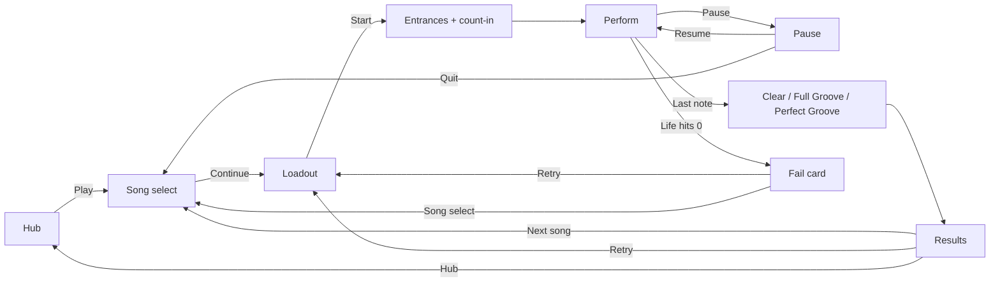

# UI Requirements — Core Loop (v1.1)

> **What this is.** The UI requirements for Encore's in-game loop: what must be on screen, the states of each element, and how every screen moves in and out. Each line cites the gamebook page it comes from. This is the list asked for in Mine the design doc for UI requirements.
>
> **Scope (v1).** Hub HUD (loop entry only) → Song select → Loadout → Perform → Results, plus the pop-up queue between them. The screens around the loop (Profile, Character, Quests, Inventory, Achievements, News, NPC dialogue, Shop) come in v2.
>
> **Visual reference.** Encore UI flow canvas. Its layouts are a guide, not a spec. It is private until its owner shares it.
>
> **Style is not decided.** UI Designer Brief — Hiring & Guidelines asks for soft pastel; UI Style records Zhong's note that pastel reads "not modern", and the current lean is a modern, Persona-like look. This doc names roles and motion, not a final look. Swap the values when the style is picked. See also `UI_STYLE.md`.
>
> **v1.1 (2026-10-18).** There are four difficulties (Easy, Normal, Hard, Expert), not five star tiers; stars are a per-song rating. Steps are stand-and-wait; the on-screen arrows are the movement d-pad.

## 0. How to read this

- **P** is priority. P0 must be on screen for that milestone, P1 should be, P2 comes later.
- **Milestone** uses the Systems database labels: Prototype, M2, M3. Things the Master Plan puts in its first public test (crowns, levels, coins, weekly boards) are marked Prototype.
- **Source** codes point at the page each line comes from:

| Code | Page |
| --- | --- |
| PROG | Player Progression & Mastery — Spec |
| PLAN | Master Plan — Dance Dance Step |
| RUN | Song Run Flow |
| PWR | Power-ups & Special Items |
| SCORE | Scoring & Grades |
| TJ | Timing & Judgement |
| COMBO | Combo Meter |
| LIFE | Life Gauge & Fail |
| TELE | Telegraph & Readability |
| ANIM | Selling Animations — Monetization × Core Gameplay |
| BRIEF | UI Designer Brief — Hiring & Guidelines |
| HUB | Encore hub: layout and art direction review (Google Doc) |
| NEW | Proposed in this doc. Not in the gamebook yet; needs Zhong's OK. |

## 1. The loop at a glance

- **Target:** a returning player gets from the hub to the first note in 3 taps (Play, Continue, Start). Song select reopens on the last pack, song and difficulty. (NEW)

## 2. Rules for every screen

### 2.1 Platform and layout

- Mobile-first, landscape. Design on a 1280×720 reference frame with Scale sizing, so it holds from a phone (about 844×390) up to PC. (BRIEF)
- Touch targets are at least 44 px. The main button sits bottom-right under the right thumb; movement controls sit bottom-left. (BRIEF)
- Keep clear of Roblox's own top bar (menu, chat and so on). Use the safe-area insets (`ScreenGui.ScreenInsets`, `GuiService:GetGuiInset()`). The flow canvas puts the player card in the top-left corner; it has to move below the inset. (NEW)
- The dance floor is sacred: no UI covers the 5×5 board during a song. (BRIEF, TJ rule 3)
- Text over the 3D world always sits on a backing plate; the scenes are bright. (BRIEF)
- PC: hover states on everything clickable; keyboard for steps, Esc for pause, Enter to confirm. Gamepad comes later. (NEW)
- Leave room for about 30% text growth for Chinese and English. (BRIEF, open decision 3)
- Performance: batched sprites and no full-screen textures per screen. The HUD must hold frame rate on a mid-range phone. (BRIEF, HUB)

### 2.2 Building it in Roblox (handoff notes)

- Roblox UI cannot skew. Slanted panels, tabs and buttons are exported images at a fixed height, 9-sliced horizontally (`SliceCenter`) so the width can stretch.
- UI motion runs on TweenService (position, size, rotation, transparency). Shines and wipes use `UIGradient` offsets. Multi-frame effects (lock shatter, crate burst, combo crack) are flipbook sprite sheets (`ImageRectOffset`).
- Effects on the floor (tile hits, Perfect bursts, shield pings) are world effects (ParticleEmitter, Beam), not ScreenGui.
- Fonts: the pitch deck uses Space Grotesk and DM Sans. Check both are in Roblox's font library; if not, pick the closest available face.
- All of 2.2 is NEW and needs engineering (ak) to confirm.

### 2.3 Interaction rules

- One primary action per screen, in the action color. The action color is only for things you can press or earn. (HUB)
- A refused action always explains itself: a shake plus the reason ("Unlocks at Lv 13"). Never a silent no-op. (Kanban card)
- The next goal is always visible: next crown, next level unlock, next pack. (PROG §7, PLAN)
- Every interactive element has these states: default, hover (PC), pressed, selected, locked with a reason, NEW badge, loading. (NEW)
- Input never waits for an animation or the beat. Press feedback lands in the same frame; the transition can finish afterwards. (NEW)
- Anything that repeats can be skipped: entrances on repeat, the results reveal on tap. (RUN rule 1, ANIM §4)

### 2.4 Color roles (working values)

| Role | Working value | Used for |
| --- | --- | --- |
| Ground | #17142E night | Screen background |
| Surface | #231F43 | Panels and cards |
| Raised | #2E2956 | Selected card, inner panels |
| Line | #463F78 | Borders and dividers |
| Text | #FAF7F4 | Titles and body |
| Muted text | #BDB5D6 | Labels and captions |
| Brand / selection | #FF7FBF pink | Selected state, section titles, Full Groove |
| Action / reward | #FFC857 gold | Primary buttons, rewards, Perfect, Perfect Groove |
| Stage accents | Lilac #C9BCE6, blossom #F2A7C8, dusk plum #3E2F6E | From the hub palette (HUB) |

Values come from the pitch deck and the hub review. If the pastel direction wins, keep the roles and swap the values. Colors that must be told apart also differ in lightness, not only hue:

- **Judgements:** Perfect gold, Great pink, Good lilac, Miss grey.
- **Crowns:** Perfect Groove gold filled, Full Groove pink filled, Clear white outline, none as a dim outline. (PROG §2)
- **Ranks:** S gold, A white, B and C muted.

### 2.5 Motion principles

1. Feedback first, flourish second.
2. Beat-aware decoration. Idle pulses follow the beat of whatever is playing (hub music, song preview). A big reveal may snap to the next beat only if that beat is less than a quarter beat away; otherwise it plays now.
3. One direction of travel. Going deeper into the loop wipes left to right; going back wipes right to left.
4. During a song, motion stays at the HUD edges. The board area has no UI motion. (BRIEF, TJ rule 3)
5. Reduced motion. Honor Roblox's reduce-motion setting (`GuiService.ReducedMotionEnabled`): wipes become 150 ms fades, shakes and flashes turn off, judgement text stays.

Principles 1, 2, 3 and 5 are NEW.

### 2.6 Motion tokens

| Token | Duration | Easing (Roblox style, direction) | Use |
| --- | --- | --- | --- |
| tap | 80 ms | Quad, Out | Press: scale 1.00 → 0.94 → 1.00 |
| quick | 150 ms | Quad, Out | Hover, toggles, tab indicator, chip changes |
| base | 250 ms | Quint, Out to enter; Quad, In to leave | Panels, sheets, cards |
| screen | 400 ms | Quint, InOut | Full-screen wipes (T1, T2) |
| slam | 250 ms | Back, Out | Rank letter, judgement pop, stamps, badges |
| count | 400–900 ms | Quart, Out | Number count-ups: score, XP, coins |
| showcase | 0.8–1.5 s | Timeline | Crate opening, level-up card |
| beat | 1 beat | Sine, InOut | Idle pulses: Play button, NEW badges, low life |

- Stagger siblings by 40–60 ms. Stagger at most 6 items; the rest arrive together. (NEW)

### 2.7 Named transitions (reuse these everywhere)

| Name | What happens | Timing | Sound | Used for |
| --- | --- | --- | --- | --- |
| T1 Slash forward | Two slanted panels (brand color, then ground) sweep left to right and cover the screen. The next screen mounts underneath, then the panels leave to the right. | 400 ms (200 in, 200 out) | Swoosh + confirm | Hub → Song select, Song select → Loadout, Loadout → stage, song end → Results, Results → Next song |
| T2 Slash back | Mirror of T1, right to left. | 400 ms | Lower swoosh | Every Back, Retry, Results → Hub |
| T3 Sheet | Panel slides 40 px in from its edge while fading in; the background dims 40%. | base | Soft open | Pickers, pause menu, fail card |
| T4 Swap | Old content fades out over 120 ms; new content fades in and rises 12 px over 200 ms. | About 250 ms | None | Tab changes, song detail changes |
| T5 Toast | Slides down from the top edge, holds 2.5 s, slides out. Tapping it opens its screen. | base in and out | Chime | Achievement, quest done, small unlocks |
| T6 Interrupt card | Background dims over 150 ms; the card slams in; tap to continue. | slam | Fanfare | Level-up, pack unlock, critical server message outside a song |
| T7 Title card | A slanted banner with the song name and difficulty crosses the screen on the beat. | 1 beat in, 1 beat out | Beat hit | Song start; song end banners |

All transitions are NEW; the slanted-panel wipe is the Persona-style signature.

### 2.8 Pop-up and announcement queue

- One pop-up at a time. Nothing pops up during a song except a critical server message, which appears as a thin banner at the top edge, outside the board. (NEW)
- After Results, pop-ups queue in this order: 1 level-up card → 2 pack unlock → 3 achievement toasts (at most 2, then "+N more") → 4 quest complete → 5 NPC dialogue (tutorial or quest) → 6 announcements. (NEW)
- Announcement priority: **Critical** (restart, shutdown) shows at once, anywhere. **High** (new song, event) goes to the hub ticker and the News badge. **Normal** goes to the News list only. (NEW)
- Nothing interrupts the entrances at song start. A toast never covers the primary button. (RUN rule 1, NEW)

## 3. Screens

### 3.1 Hub HUD (loop entry)

**Job:** get into a song in one tap; show who you are and what is new.

**Enters from:** spawn, Results (Hub), any Back. **Exits to:** Song select (Play); the screens around the loop (v2).

| Element | What it shows | States | P | Milestone | Source |
| --- | --- | --- | --- | --- | --- |
| Play button | Opens Song select | Default, pressed, beat pulse | P0 | Prototype | NEW |
| Player card | Name, level, XP bar, Dance Grade (from Lv 10) | Default; NEW when an unlock is waiting | P0 | Prototype | PROG §3, §5 |
| Currencies | Beat Coins; Fans (earned only, never bought) | Counts up on change | P0 | Prototype | PLAN; PROG §2 |
| Next goal | One line, such as "6 Fans to Pack 3" or "Lv 13: Expert difficulty" | Hidden when nothing is close | P1 | Prototype | PROG §7 |
| Announcement ticker | Top active message with a type tag and unread count; tap opens News | Rotating; critical style | P1 | M2 | NEW |
| Daily quests | 3 dailies with progress; opens at Lv 2 | In progress, claimable, all done | P1 | Prototype | PROG §5 |
| Menu | Character, Quests, Inventory, Achievements, News, Shop, Settings | NEW badge; hidden until unlocked | P0 | Varies | PROG §5; v2 of this doc |

| Moment | What moves | Timing | Sound | Source |
| --- | --- | --- | --- | --- |
| Arrive in the hub | Each HUD group slides in from its own edge; Play arrives last with a slam | base, 60 ms stagger | None | NEW |
| Play idle | Scales 1.00 → 1.04 on every beat; a shine sweeps across every 4 bars | beat; shine 600 ms | None | NEW |
| Tap Play | Press, then T1 to Song select | 80 + 400 ms | Confirm + swoosh | NEW |
| Currency changes | Number counts up and the icon bounces; rewards fly from their source to the counter on an arc | count 600 ms; flight 400 ms | Coin ticks | NEW |
| Ticker | Long text scrolls at 40 px/s; messages rotate every 6 s with a vertical slide; a touch pauses it | quick slide | None | NEW |
| A menu unlocks | The entry slams in where it will live; its NEW badge pulses until opened | slam, then beat | Unlock chime | PROG §5 |

- **First session (Lv 1):** show only Play, the player card and the currencies. Menus appear as they unlock (quests at Lv 2, item shop and first slot at Lv 4, and so on) rather than sitting greyed out from day one. (PROG §5, NEW)

### 3.2 Song select

> ⚠️ RUN flags this screen as unspecced and the one players touch most. This section is the proposal.

**Job:** pick a song and difficulty fast; see your mastery and the next crown.

**Enters from:** Hub (Play), Results (Next song). **Exits to:** Loadout (Continue), Hub (Back).

| Element | What it shows | States | P | Milestone | Source |
| --- | --- | --- | --- | --- | --- |
| Pack tabs | Pack name; locked packs show the Fans needed (8, 20, 40, 70) | Selected, open, locked with Fans needed, NEW | P0 | M2 | PROG §2 |
| Song rows | Jacket, title, artist, BPM, star rating, one crown per difficulty (4), best rank, NEW tag | Selected; difficulties locked | P0 | Prototype | PROG §1, §2; BRIEF |
| Featured song | One highlighted song (new drop or event) | — | P1 | M2 | BRIEF |
| Song detail | Jacket, title, artist, BPM, audio preview | Preview playing | P0 | Prototype | NEW |
| Difficulty selector | Easy, Normal, Hard, Expert. Locked difficulties show their level: Normal Lv 5, Hard Lv 9, Expert Lv 13 | Selected, open, locked with level | P0 | Prototype | PROG §1, §5 |
| Your best on this difficulty | Rank, score, max combo, crown | "Not played yet" | P0 | Prototype | PROG §2; SCORE |
| Next crown | The next crown and what it pays: "Full Groove (no Miss) → +1 Fan" | "Mastered" once Perfect Groove is held | P0 | Prototype | PROG §2, §7 |
| Fans | Total and the next pack threshold | — | P0 | M2 | PROG §2 |
| Weekly board | Your rank on this song this week (from Lv 8) | Not ranked yet | P1 | Prototype | PROG §5; SCORE rule 4 |
| Sort and filter | By difficulty, not yet cleared, BPM | — | P1 | M2 | NEW |
| Continue | Primary action | Disabled only while loading | P0 | Prototype | NEW |
| Memory | Reopens on the last pack, song, difficulty and scroll position | — | P0 | Prototype | NEW |

| Moment | What moves | Timing | Sound | Source |
| --- | --- | --- | --- | --- |
| Enter | T1; rows stagger in from the right; the detail panel rises in | screen; 40 ms stagger | Swoosh | NEW |
| Select a song | Highlight slides to the row; detail swaps (T4); preview audio crossfades once the finger has rested 300 ms | quick; T4; 300 ms crossfade | Row tick | NEW |
| Change difficulty | Indicator slides between difficulties; best-score numbers roll to the new values; that difficulty's crown pulses once | quick; count 400 ms | Tier tick | NEW |
| Tap a locked difficulty or pack | Shake (3 × ±6 px) and a tooltip with the reason: "Unlocks at Lv 13", "Needs 20 Fans" | 200 ms shake; tooltip 2 s | Soft error | Kanban card |
| A pack unlocks | First visit after crossing the threshold: the lock shatters (flipbook), the tab slams open, NEW badge | 400 ms + slam | Unlock chime | PROG §2 |
| Continue | Press, then T1 to Loadout | 80 + 400 ms | Confirm | NEW |
| Back | T2 to Hub | 400 ms | Back | NEW |

- **New player:** only Easy is open on every song. The difficulty selector still shows all four with their unlock levels, so the next goal is visible. (PROG §5, §7)

### 3.3 Loadout (skills and item skills)

> 🧩 **Proposed split, to confirm:** skills are learned by leveling up and kept for good. Items are used up per run, and each item grants one extra skill. Both carry a score multiplier below 1, so an assisted clear never outscores a clean one (PWR rule 1). Slot capacity comes from levels and grades, never from money (PWR rule 3).

**Job:** choose helpers for this run, see the score cost, confirm your look.

**Enters from:** Song select (Continue), Results (Retry), fail card (Retry). **Exits to:** Perform (Start), Song select (Back).

| Element | What it shows | States | P | Milestone | Source |
| --- | --- | --- | --- | --- | --- |
| Song and difficulty | The chosen song and difficulty | — | P0 | Prototype | RUN |
| Skill slots (3) | Slot 1 opens at Lv 4, slot 2 at Lv 12, slot 3 with a Dance Grade | Filled, empty, empty with a NEW skill, locked with how to open | P0 | Prototype | PWR rule 3; PROG §3, §5 |
| Skill card | Icon, name, one-line effect, score multiplier. Example: Groove Shield, absorbs 3 Misses, ×0.9 | — | P0 | Prototype | PWR catalog |
| Item slots | Item icon, name, the skill it grants, multiplier, how many you own. Example: Slow-Time Charm grants Slow-Time (song 8% slower), ×0.8 | Filled, empty, 0 left | P0 | Prototype | PWR |
| Boosts | Double Coins (×2 coins), XP Boost (×1.5 XP), labelled "score unchanged" | On, off, none owned | P1 | M2 | PWR; Boosts row |
| Run multiplier | Combined score multiplier with an ASSISTED tag; "×1.00 CLEAN" with no helpers | Clean, assisted | P0 | Prototype | PWR rule 1; SCORE rule 3 |
| Go clean | Removes every helper for this run | — | P1 | Prototype | NEW |
| Board note | How assisted runs show on the weekly board | — | P1 | M2 | PROG §8.1 |
| Look this run | Entrance, Perfect burst, victory pose, labelled "looks never change score" | Per slot or as a set (open) | P1 | M2 | ANIM §1, §5.2 |
| Avatar preview | Your outfit; tap a look to preview it on the avatar | Previewing | P1 | M2 | ANIM §4 |
| Picker | Sheet listing owned skills or items with effect, multiplier and count; equip and unequip | Empty: "Get more" (Shop, M2) | P0 | Prototype | NEW |
| Start | Primary action; locks the loadout for the run | — | P0 | Prototype | RUN rule 3 |
| Grade course version | Helper sections replaced by "Items are off in Dance Grade courses" | — | P1 | M2 | PWR rule 2; RUN rule 4 |

| Moment | What moves | Timing | Sound | Source |
| --- | --- | --- | --- | --- |
| Enter | T1; slot cards stagger in | screen; 60 ms stagger | Swoosh | NEW |
| Open the picker | T3 from the right | base | Soft open | NEW |
| Equip | Card flies from the picker into the slot and lands with a small overshoot; the slot edge flashes; the multiplier rolls down; the ASSISTED tag slams in on the first helper | base + count 400 ms | Equip click | NEW |
| Unequip | Card drops 12 px and fades; the multiplier rolls up; at ×1.00 the CLEAN tag appears with a sparkle | quick + count 400 ms | Unequip | NEW |
| New skill ready | The empty slot breathes with a NEW badge until the skill is equipped or dismissed | beat | None | NEW |
| Tap a locked slot | Shake and "Opens with a Dance Grade" | 200 ms | Soft error | Kanban card |
| Preview a look | The entrance plays on the avatar preview; tap again to stop | Up to 3 s | The look's own | ANIM §4 |
| Start | A shine sweeps across the equipped slots as they lock, then T1 to the stage | 300 + 400 ms | Ready stinger | RUN rule 3 |

- **An item runs out:** its slot shows "0 left" next time and the run is clean unless you pick another. (NEW)
- **When is an item used up** (on Start, on the first judged note, or on clear)? The UI needs this to say "used" or "refunded" when a player quits. See Decisions. (NEW)

### 3.4 Perform (in-song HUD)

**Job:** let the player read the floor and stand on the beat, with score, combo and life readable and nothing on the floor.

**Enters from:** Loadout (Start), Pause (Resume). **Exits to:** Results (song end), fail card (life at 0), Song select (Quit from pause).

| Element | What it shows | States | P | Milestone | Source |
| --- | --- | --- | --- | --- | --- |
| Board safe area | The 5×5 floor, kept clear of all HUD | — | P0 | Prototype | BRIEF; TJ rule 3 |
| Telegraph | The next target tile and the one after, with the beats left (W = 4, 2 or 1 by difficulty) | Appearing, counting down, hit, missed | P0 | Prototype | TELE (look unwritten); PROG §1 |
| Judgement pop | Perfect, Great, Good, Miss. Near the avatar, never over the next target, gone within 0.5 s | 4 judgements | P0 | Prototype | TJ rule 3; BRIEF |
| Perfect burst | The equipped burst on every Perfect (world effect, 0.5 s or less) | Default, equipped | P1 | M2 | ANIM §2; TJ rule 4 |
| Combo | Count and label; flares at x10, x25, x50 | Climbing, milestone, broken | P0 | Prototype | COMBO; ANIM §2 |
| Score | Running score; multiplier chip on assisted runs | Clean, assisted | P0 | Prototype | SCORE |
| Life gauge | Life left; you clear by finishing with life remaining | Normal, low (under 25%), empty | P0 | Prototype | LIFE (drain unset); PROG §2 |
| Song progress | How far through the song | — | P0 | Prototype | BRIEF |
| Helper status | One chip per equipped helper with its live state (Groove Shield 3/3 → 2/3) | Active, triggered, spent | P0 | Prototype | PWR |
| Pause | Pause button (Esc on PC) | — | P0 | Prototype | NEW |
| Movement d-pad | On-screen arrows on touch that move the avatar between tiles (steps are stand-and-wait, not tapped on the beat); can be hidden in Settings | Pressed | P0 | Prototype | BRIEF (d-pad toggle) |
| Active skill button | A reserved thumb spot, used only if active skills are approved | Ready, cooling down | P2 | TBD | PWR open item (A-to-B speed skill) |
| Other players | Names and combo flares in coop or PvP | — | P2 | M3 | ANIM §2; Multiplayer row |

#### Song start sequence (Start → first note)

| Step | What happens | Timing | Source |
| --- | --- | --- | --- |
| 1 | T1 covers the screen and the stage loads underneath. If loading takes over 400 ms, a title card (song, difficulty) shows on the cover. | 200 ms + load | NEW |
| 2 | Stage revealed with the HUD hidden. Each player's entrance plays and everyone watches. Skippable on repeat. | Up to 3 s each | RUN rule 1; ANIM §4 |
| 3 | T7 title card: song name and difficulty cross the screen on the beat. | 2 beats | NEW |
| 4 | HUD slides in from its edges: progress, score, life, combo, helper chips, controls. | base, 60 ms stagger | NEW |
| 5 | Count-in on the beat: 3, 2, 1, GO, each slamming in. The first telegraph appears during the count-in so the player can move early. | 4 beats | NEW; TELE |
| 6 | First note. | — | — |

#### During the song

| Element | Trigger | Animation | Timing | Source |
| --- | --- | --- | --- | --- |
| Telegraph | A target is due in W beats | Tile outline appears; a ring shrinks one step per beat; flashes on the target beat | Per beat | TELE (design needed) |
| Judgement pop | Each judged step | Pops in large and settles, holds, fades. Miss drops down and greys | 120 + 200 + 150 ms, 500 ms max | TJ rule 3 |
| Combo bump | Each hit | Number scales up 12% and settles | 80 ms | COMBO |
| Combo milestone | x10, x25, x50 | Burst around the counter plus the equipped flare; other players can see it | 0.5 s max | ANIM §2 |
| Combo break | A Miss | Number drops 8 px, greys, small shake, resets to 0 | 150 ms | COMBO (break rule unwritten) |
| Score | Score changes | Rolls up; at most 10 updates per second on dense charts | 150 ms | NEW |
| Life loss | Life drops | Bar shrinks; a light chunk trails behind and catches up | 200 + 300 ms | LIFE |
| Low life | Under 25% | Gauge pulses on the beat; faint pink vignette at the screen edges only, never on the board | beat | NEW |
| Shield absorbs a Miss | Groove Shield triggers | Chip flashes and the count ticks down; a small shield ping on the avatar | quick | PWR |
| Pause | Pause pressed | Audio stops at once; T3 pause panel (Resume, Retry, Quit); board dims 60% | base | NEW |
| Resume | Resume pressed | 3-beat count-in before the audio restarts | 3 beats | NEW |

#### Song end and fail

| Moment | What happens | Timing | Source |
| --- | --- | --- | --- |
| Last note | Hold one beat, then a result banner slams in: CLEAR, FULL GROOVE or PERFECT GROOVE | 1 beat + 1.2 s | PROG §2 |
| Full-combo finale | The equipped finale plays, only on runs with no Miss | TBD with animation | ANIM §2 |
| To Results | HUD slides out, then T1 | 150 + 400 ms | NEW |
| Life hits 0 | Music slows and stops, the board desaturates, a FAILED banner, then the fail card (T3): Retry, Song select | 400 + 300 ms + base | LIFE; RUN open item |

- **Audio calibration:** judgement windows mean nothing without it (TJ rule 2). The UI needs a calibration screen in Settings and a prompt on first run. (Audio Sync & Latency row)
- **Critical server message mid-song:** thin banner at the top edge only (2.8).
- **Disconnect mid-song:** what the player sees when they come back is still open. (NEW)

### 3.5 Results

**Job:** celebrate; show rank, score and combo; pay out; send the player into the next song.

**Enters from:** Perform (song end). **Exits to:** Song select (Next song, T1), Loadout (Retry, T2), Hub (T2).

| Element | What it shows | States | P | Milestone | Source |
| --- | --- | --- | --- | --- | --- |
| Song and difficulty | — | — | P0 | Prototype | RUN |
| Rank | S, A, B or C, large | S has its own treatment | P0 | Prototype | SCORE rule 1 (cutoffs open) |
| Score | Final score, with a "×0.72 assisted" label on assisted runs | Clean, assisted | P0 | Prototype | SCORE rule 3 |
| Max combo | Best combo this run | — | P0 | Prototype | Zhong's list |
| Accuracy | Percentage, and counts of Perfect, Great, Good, Miss | — | P0 | Prototype | BRIEF; TJ |
| New best | NEW BEST and the previous best | Only when beaten | P0 | Prototype | NEW |
| Crown | Crown earned or upgraded, and Fans gained (an upgrade pays the difference) | New, upgraded, unchanged | P0 | Prototype | PROG §2 |
| Pack unlock | Shown when Fans cross a threshold | — | P0 | M2 | PROG §2 |
| XP | Base 40 + rank bonus (S 60, A 40, B 25, C 10) + first clear 50, then the level bar | Level-up | P0 | Prototype | PROG §5 |
| Level-up card | The new level and what it unlocks | — | P0 | Prototype | PROG §5 |
| Coins | Coins earned; Double Coins shown as ×2 | — | P0 | Prototype | PLAN |
| Result crate | Crate whose odds improve with rank; S doubles rare odds | Closed, opening, revealed, duplicate turned into coins | P0 slot | M2 content | RUN rule 2; PROG §2 |
| Weekly board | Your place on this song this week and the change (from Lv 8) | Up, down, new | P1 | Prototype | SCORE rule 4 |
| Victory pose | On your avatar | — | P1 | M2 | ANIM §1 |
| Share card | From Lv 11 | — | P1 | Prototype | PROG §5; BRIEF |
| Quest ticks | Quests this run moved forward | — | P1 | Prototype | NEW |
| Actions | Next song (primary), Retry (same loadout), Hub | — | P0 | Prototype | RUN |

#### Reveal timeline

Tap anywhere to jump to the final state; the rewards are the same either way.

| Time | What happens | Timing | Sound |
| --- | --- | --- | --- |
| 0.0 s | T1 in; the stage dims behind; the victory pose starts | 400 ms | Swoosh |
| 0.2 s | Song and difficulty banner slides in | base | — |
| 0.4 s | Score counts up from 0; the digits settle with a slam | count 900 ms | Fast ticks |
| 1.0 s | Action buttons appear and work; pressing one skips the rest | base | — |
| 1.3 s | Max combo and accuracy count up | count 500 ms, 80 ms stagger | Ticks |
| 1.6 s | Judgement bar fills segment by segment: Perfect, Great, Good, Miss | 400 ms | — |
| 2.1 s | Rank letter slams in from large with a 2 px screen shake; S adds a gold flash and sparkle | slam | Rank hit (bigger for S) |
| 2.5 s | NEW BEST stamp | 200 ms slam | Stamp |
| 2.8 s | Crown flips from old to new; "+1 Fan" flies to the Fans counter | 300 + 400 ms | Crown chime |
| 3.3 s | XP bar fills. On a level-up the timeline pauses for the level-up card (T6) | count 700 ms | Level-up fanfare |
| 3.8 s | Coins count up; the crate drops in and wiggles on the beat | count 600 ms; drop 400 ms Back, Out | Coin ticks, thud |
| About 4.5 s | Done; queued pop-ups start (2.8) | — | — |

#### Crate opening

| Step | What happens | Timing |
| --- | --- | --- |
| Tap the crate | Crate shakes on 3 beats; its glow color hints at the rarity | 3 beats |
| Open | Lid bursts (flipbook) | 400 ms |
| Reveal | Item card flips over; rarity banner slams in | 300 ms + slam |
| Duplicate | The card turns into coins that fly to the counter | count 600 ms |
| Odds | An "Odds" link on the crate (the compliance pass is still open, PROG §8.3) | — |

Source: RUN rule 2, PROG §2 and §8.3; timings are NEW.

- **Assisted run:** score label and weekly-board flag. (PROG §8.1)
- **Failed run:** goes to the fail card, not Results, until Zhong decides otherwise. (RUN open item)

## 4. What the designer delivers for the loop

- [ ] Style sheet v1: color roles, type scale, spacing. The style direction has to be picked first.
- [ ] Component kit: primary, secondary and icon buttons; slanted panels as 9-slice; chips; tabs; progress bars; crown icons in 4 states; rank letters S, A, B, C; difficulty selector in all states; slot cards (filled, empty, new, locked).
- [ ] Hub HUD: default, first session (Lv 1), NEW badges, ticker (normal and critical).
- [ ] Song select: default, song selected, locked difficulty tapped, locked pack, no best yet, pack unlock moment.
- [ ] Loadout: empty, assisted, clean, picker open, locked slot, new skill ready, Dance Grade course version.
- [ ] Perform: HUD default, telegraph at W = 4, 2 and 1, the 4 judgements, combo milestones (x10, x25, x50), combo break, low life, pause, fail, the 3 end banners, count-in.
- [ ] Results: final state for S, A and C; level-up card; crate opening frames; share card.
- [ ] Motion prototype (video or clickable, 10–20 s each): Hub → Song select → Loadout → song start sequence, and the Results reveal.
- [ ] Exports: sprites with 9-slice specs; flipbooks (lock shatter, crate burst, combo crack); Roblox handoff notes (ScreenGui, Scale vs Offset).

## 5. Decisions that block the UI

| # | Question | Blocks | Decides | Source |
| --- | --- | --- | --- | --- |
| 1 | Style direction: soft pastel (BRIEF) or modern, Persona-like (Zhong) | All visuals | Zhong | UI Style row; BRIEF |
| 2 | Skills learned and kept vs items used up, each granting a skill | Loadout; Character (v2) | Zhong | NEW |
| 3 | How score multipliers stack: multiply, add, or cap | Loadout; Results | Zhong | PWR; SCORE |
| 4 | Active skills with a button, or passive only (the A-to-B speed skill) | Perform thumb zone | Zhong | PWR open item |
| 5 | Score formula and the S, A, B, C cutoffs | Results; Song select | Zhong | SCORE open items |
| 6 | Life drain, recovery and start value (code has per-difficulty values in `LifeGauge.luau`) | Perform | Zhong | LIFE row |
| 7 | What the telegraph looks like | Perform | Both | TELE row |
| 8 | Fail flow: instant retry, back to select, or a cost | Perform; Results | Zhong | RUN open item |
| 9 | Solo, coop or PvP by default, and how many players share a board | Perform; entrances | Zhong; ak | RUN open item; Multiplayer row |
| 10 | Effects equipped per slot or as one set | Loadout "Look" | Zhong | ANIM §5.2 |
| 11 | Assisted runs on weekly boards: separate board, flag, or clean only | Loadout; Results; Song select | Zhong | PROG §8.1 |
| 12 | When an item is used up: on Start, on the first judged note, or on clear | Loadout; pause Quit | Zhong; ak | NEW |
| 13 | Where each song's preview clip starts | Song select | ak | NEW |
| 14 | Whether the deck fonts exist in Roblox's font library | All text | Designer; ak | NEW |

## 6. Changelog

- v1, September 29, 2026: first version, built from the flow canvas and the gamebook pages above. Covers the in-game loop only; v2 adds the screens around the loop.
- v1.1, October 18, 2026: five star tiers replaced by four difficulties (stars are a per-song rating); step controls renamed the movement d-pad; difficulty unlock levels set to Normal Lv 5, Hard Lv 9, Expert Lv 13.
